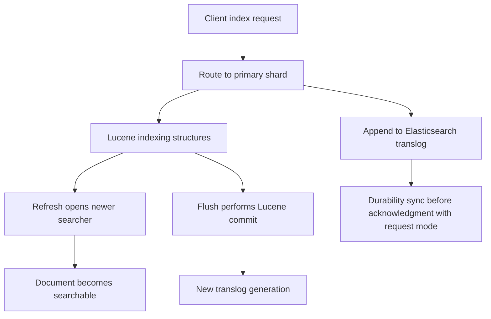

# Chapter 01 — Production Search Architecture

## 1. The problem

A retail application stores products in a transactional database, but users expect fast free-text searches across names, descriptions and brands, with relevance ranking and structured filters.

A leading-wildcard predicate such as `LIKE '%vitamin%'` generally cannot perform an efficient prefix seek on an ordinary B-tree index. But **Oracle and other relational databases also support full-text search**, so the architectural decision is workload-specific; never say "SQL cannot rank search results."

A dedicated search projection can separate the **authoritative relational record** from a **search-optimized document**. This gains search flexibility but introduces synchronization, staleness, deletes and rebuild complexity.

## 2. Text becomes indexed terms

Example source document:

```json
{"productId":"P101","name":"Organic Vitamin C 500mg","brand":"NatureWell","inStock":true}
```

A standard analyzer can yield the tokens `organic`, `vitamin`, `c`, `500mg` through tokenization and lowercase filtering. Exact output depends on analyzer configuration. The standard analyzer does **not** inherently provide English stemming or arbitrary synonym expansion.

An inverted index reverses document-to-terms into term-to-document postings:

```text
organic -> P101, P103
vitamin -> P101, P102
herbal  -> P103
```

For AND matching, intersect postings; for OR, combine candidates. Real postings may also include term frequencies and positions for scoring and phrase matching. Finding candidates is **not** the same as ordering by relevance.

## 3. Lucene storage: writer, segments and searcher

- **IndexWriter** processes documents and manages in-memory indexing buffers.
- **Segment** is a largely immutable searchable collection of term/postings, stored fields and other Lucene structures.
- **IndexReader / IndexSearcher** supplies a particular snapshot-like searchable view of index contents.

A segment can exist without being visible to an already-open searcher. A refresh exposes recent changes through a new/reopened reader view; it may first need to flush pending in-memory changes to segment files. Existing searches can finish using old readers.

Updates are conceptually delete-old-version + add-new-version, rather than mutating an immutable segment in place. Background segment merges consolidate data and can reclaim deleted-document space, but cost CPU, disk I/O and temporary storage.

## 4. JVM heap, OS page cache and persistent files

Distinguish these memory regions:

| Layer | Typical role |
|---|---|
| JVM heap | Indexing buffers, query objects, JVM-managed structures |
| OS page cache | Cached file-backed Lucene segment pages |
| Persistent storage | On-disk Lucene files and translog |

Lucene searches files via its directory abstraction, often using memory-mapped access. Whether the access requires disk I/O depends on page-cache residency. **Elasticsearch flush does not switch searches from RAM to disk.** A committed segment can still be served from cached RAM pages.

## 5. One document's write lifecycle

Conceptual primary-shard flow:



This diagram shows complementary responsibilities, not a strict serialization of concurrent internal actions. Replicas have their own local indexing and recovery.

### Refresh

A refresh makes recent changes searchable. It does **not** necessarily establish a durable Lucene commit. New segment data may initially be in filesystem cache. Automatic refresh behavior depends on index settings, activity and deployment configuration. `refresh=true` requests an immediate refresh; `refresh=wait_for` normally waits for a refresh to expose a write.

### Translog

The translog records operations needed to recover changes not included in a durable Lucene commit. With default `index.translog.durability=request`, the applicable translog synchronization requirements are met before a successful acknowledgment. With `async`, a crash may lose some recently acknowledged operations.

**Appending to a file and fsync-ing it are not synonyms.** The durability guarantee also assumes underlying storage honors sync requests.

### Flush versus internal Lucene flush

- **Lucene buffer flush:** writes buffered index data to segment files, not necessarily a durable commit.
- **Elasticsearch refresh:** exposes the latest index changes to searchers.
- **Elasticsearch flush:** executes a Lucene commit and begins a new translog generation.
- **Merge:** consolidates segments; neither a refresh nor durability commit.

A durable Lucene commit establishes a consistent committed segment set, with commit metadata (e.g. `segments_N`). A translog provides recovery for needed subsequent operations. Automatic flush behavior is heuristic; do not memorize universal "30-minute/512MB" claims.

## 6. GET by ID versus search

A default real-time GET can see an acknowledged write before search refresh through shard-local real-time state (including the recent-operation retrieval path), while a search query uses a reader view that may not yet include that write.

Example: P101 originally has price 12.99. After updating to 10.99 but before refresh, GET can return 10.99 while search can still expose the older indexed version. After refresh the search view reflects the update.

## 7. Minimal experiment

Run in a disposable local/test Elasticsearch environment:

```http
PUT search-lab
{"settings":{"number_of_shards":1,"number_of_replicas":0,"refresh_interval":"-1"}}

PUT search-lab/_doc/P101
{"name":"Organic Vitamin C"}

GET search-lab/_doc/P101
GET search-lab/_search
{"query":{"match":{"name":"vitamin"}}}

POST search-lab/_refresh

GET search-lab/_search
{"query":{"match":{"name":"vitamin"}}}

GET search-lab/_segments
DELETE search-lab
```

The pre-refresh search need not see the document; the default GET can. Explicit refresh makes it searchable. Avoid applying single-node replica settings to production.

## 8. Failure mental model

| Failure point | What to expect |
|---|---|
| Before acknowledgment | Request outcome may be uncertain |
| After successful acknowledgment, before refresh | Not necessarily searchable; recoverable under default durability assumptions |
| After refresh, before Lucene commit | Searchable; recovery can depend on translog |
| After durable Lucene commit | Commit provides durable index state |

## 9. Spoken answer

> "When Elasticsearch indexes a document, it routes the operation to the appropriate primary shard. Lucene processes the indexed fields and builds in-memory indexing structures, while Elasticsearch records the operation in its translog. Under normal request durability, the translog is synced before a successful acknowledgment. A later refresh opens a searcher that can see recent segment data, but it isn't the same as a durable Lucene commit. If the node crashes before that commit, the translog helps recover acknowledged operations. A flush establishes the durable Lucene checkpoint and advances the translog lifecycle."

## Revision

- Inverted index = find candidates; BM25 = rank lexical candidates.
- Segment existence ≠ searcher visibility ≠ durable Lucene commit.
- Refresh = visibility; translog = recovery; ES flush = durable Lucene commit; merge = segment optimization.
- GET and search can temporarily disagree.
- Memory mapped segment data is file-backed; not equivalent to copying entire segments into JVM heap.
