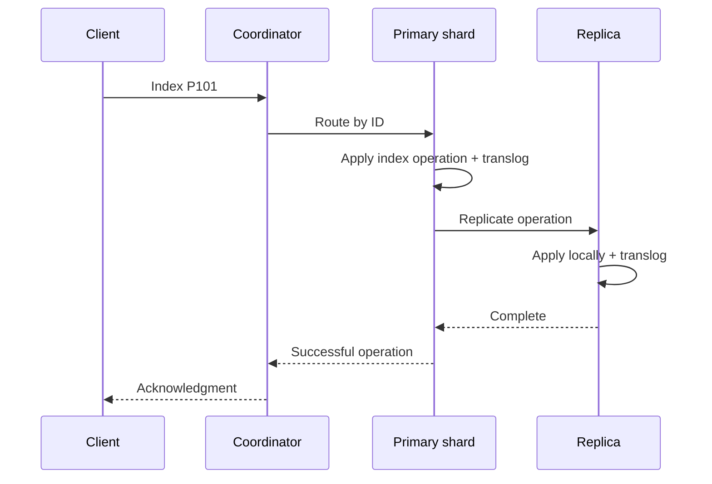
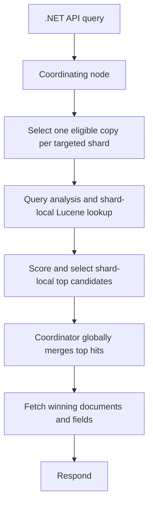
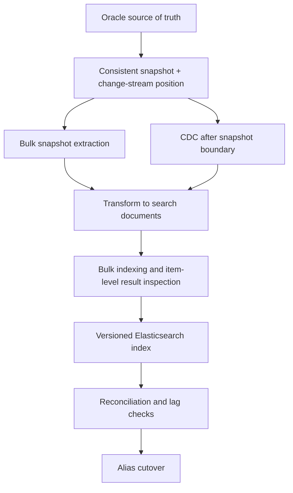

# Chapter 02 — Distributed Search and Oracle Migration

## 1. Partitioning versus redundancy

An Elasticsearch primary shard is a separate Lucene index containing a subset of the logical index's documents. Three primaries means three distinct partitions. One replica per primary means six **copies**, not six distinct data partitions.

Sharding distributes storage and work; replication provides failover and potentially more concurrent search-serving capacity. More replicas add indexing/replication overhead and don't automatically speed up one shard-local query.

Each shard copy has its own Lucene indexing structures, segments, refresh and translog.

## 2. Routing

For ordinary document writes, Elasticsearch uses deterministic routing based on document ID or an explicit routing value to select a primary shard. Exact formulas depend on the index creation version and routing configuration; think `target = f(routing, configuration)`, not a universal modulus shortcut.

Custom tenant routing can reduce search fan-out, but a very large tenant can overload one shard. All GET/update/delete operations for custom-routed documents must use consistent routing.

## 3. Distributed write protocol



Replicas do not ordinarily receive a completed segment file on each write. They apply operations locally and can have different segment layouts from primaries. The write protocol maintains a set of **in-sync copies**, removing failed copies appropriately before successful acknowledgment. `wait_for_active_shards` controls pre-write shard availability, not a substitute for durability or a universal per-replica fsync promise.

After a primary fails, an eligible in-sync replica can be promoted. Client timeouts may still leave write outcome **unknown**, so stable IDs, idempotency and concurrency control matter.

## 4. Distributed query-then-fetch



Search generally fans out to **one eligible copy per participating shard**, not every replica. Adaptive replica selection considers shard-copy performance signals.

Query phase finds scored candidates; fetch phase retrieves requested stored content. Deep `from/size` windows can increase distributed candidate collection and memory use. Shard-local statistics can make BM25 scores differ across shards; `dfs_query_then_fetch` obtains more global statistics with extra round-trip cost.

## 5. Oracle → Elasticsearch: source-of-truth migration

The migration challenge is not copying documents once. It is constructing a derived index while source records continue changing.

A robust **hypothetical** pipeline:



The snapshot and CDC offsets must correspond. Otherwise there can be gaps or overlap races. A slow snapshot write must not overwrite a newer CDC update.

### Out-of-order update example

| Event | Source version |
|---|---:|
| Snapshot P101 price 12.99 | 100 |
| Price update 10.99 | 101 |
| Status discontinued | 102 |
| Delete | 103 |

If the delete arrives and a delayed snapshot index operation later arrives, a naïve pipeline may recreate a deleted product.

**External versioning** on Elasticsearch indexing operations permits only a strictly newer source version:

```http
PUT products-v2/_doc/P101?version=101&version_type=external
{"productId":"P101","price":10.99,"deleted":false,"sourceVersion":101}
```

But a hard delete retains version history only for a bounded interval (`index.gc_deletes`). A sufficiently late older write can resurrect the document after that history expires.

A **logical tombstone** can preserve the deletion version as a stored document:

```http
PUT products-v2/_doc/P101?version=103&version_type=external
{"productId":"P101","sourceVersion":103,"deleted":true}
```

Customer searches consistently filter `deleted=false`; tombstones must be retained until stale write arrival can be ruled out, or a durable latest-version mechanism must exist elsewhere. They use index space and require a retention policy.

External versions require a reliable **per-product ordered source version**, not a random worker timestamp. A 409 conflict may be an expected stale/duplicate operation but must not automatically be ignored without checking the version contract.

### Bulk API is not transactional

Successful HTTP status can accompany individual `errors:true` items. Inspect every item: retry eligible temporary failures with backoff/jitter, quarantine invalid mappings, and reconcile unknown-timeout outcomes. Don't retry data errors infinitely.

### Aliases

`products-read -> products-v1` can be changed atomically to `products-v2`. Atomic alias switching does **not** guarantee the new index is synchronized. Keep a validated rollback option, remembering that an old index becomes stale if its updates are stopped.

### Cutover validation

Confirm completeness, item-level failures, CDC lag, version ordering, deletion correctness, mappings, representative relevance and latency. Agree on explicit business acceptance for any residual lag or known missing documents.

## 6. Mini Elasticsearch queries

```http
GET products-v2/_search
{"query":{"bool":{"must":[{"match":{"name":"organic vitamin"}}],"filter":[{"term":{"inStock":true}},{"term":{"deleted":false}}]}}}

GET products-v2/_search?search_type=dfs_query_then_fetch
{"query":{"match":{"name":"organic vitamin"}}}
```

## 7. Interviews

**Q: Why not just use Oracle Text?** Oracle already has full-text search capabilities. Compare workload, latency, ranking requirements, operational complexity, replication, data freshness and costs. Don't claim SQL cannot perform full-text relevance.

**Q: How do you prevent snapshot/CDC races?** Establish a consistent snapshot boundary and change-stream position, stable document IDs, ordered source versions, version-aware writes, durable deletion strategy, reconciliation and safe alias cutover.

**Q: Does a primary send segments to replicas?** For ordinary writes, Elasticsearch replicates operations; replicas index and record their own local state. Logical document state is the contract, not identical segment layouts.

## Revision

- Shards partition; replicas copy.
- Route writes deterministically; query may fan out across shards.
- Coordinator merges top candidates, then fetches fields.
- Source snapshot + CDC boundary + version control + deletes + reconciliation are all needed.
- Timeout ≠ failed write; alias cutover ≠ data correctness.
