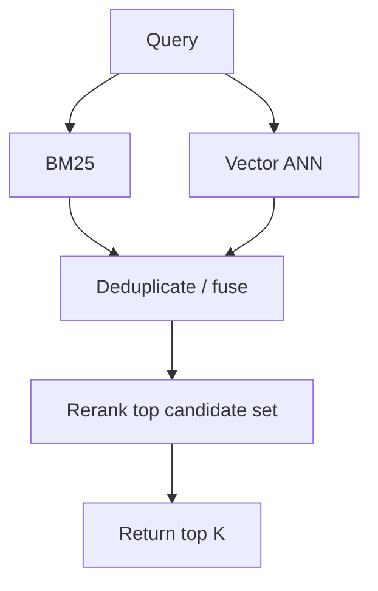

# Chapter 03 — Relevance and Hybrid Retrieval

## 1. Retrieval versus ranking

Elasticsearch can return healthy HTTP responses quickly while giving poor search results. Separate **missing candidate** problems (mapping, analyzer, vocabulary, filters) from **bad ordering** problems (scoring, boosts, relevance signals).

A standard analyzer tokenizes/lowercases but doesn't automatically stem or expand synonyms. Search and index analysis must be compatible.

## 2. BM25 internals

BM25 rewards query terms based on frequency, rarity and field length, with diminishing returns for repeated terms. A representative formula is

```text
score(q,D) = Σ IDF(t) × [ f(t,D)(k1+1) /
                ( f(t,D) + k1(1-b + b|D|/avgdl) ) ]
IDF(t) = ln(1 + (N - n(t) + 0.5)/(n(t) + 0.5))
```

where `f` is term frequency, `n` is document frequency, `|D|` is field length. BM25 is **lexical relevance**, not meaning or evidence correctness.

Illustration: N=100, avgdl=10, document length=8, k1=1.2, b=.75; organic appears in 10 docs once in candidate, vitamin in 20 docs twice. Approximate respective contributions are 2.47 and 2.32, total ~4.79 (under assumed statistics).

## 3. Query and mapping choices

```http
PUT relevance-lab
{"mappings":{"properties":{
  "name":{"type":"text","fields":{"raw":{"type":"keyword"}}},
  "description":{"type":"text"},
  "category":{"type":"keyword"},
  "inStock":{"type":"boolean"}
}}}

GET relevance-lab/_search
{"query":{"multi_match":{"query":"magnesium glycinate","type":"best_fields","fields":["name^4","description"]}}}
```

`best_fields` favors the strongest field match; AND applies to field-specific queries and may exclude a document whose terms are split across fields. `combined_fields` can support cross-field term-centric matching for compatible text fields.

**Fuzziness** addresses minor spelling edits; **stemming** normalizes some morphological variants; **synonyms** encode controlled lexical relationships; **domain taxonomy** encodes curated business semantics. These are not interchangeable with semantic embeddings. Product-health relationships should be validated, not fabricated as synonyms.

```http
GET relevance-lab/_search
{"query":{"match":{"name":{"query":"magnesum","fuzziness":"AUTO"}}}}
```

Check `_analyze` for tokens, `_explain` for score calculation, `_profile` for execution work and `_rank_eval` for evaluation against judgments.

## 4. Quantitative relevance

Suppose three relevant documents exist; top five include two relevant:

- Precision@5 = 2/5 = 0.40
- Recall@5 = 2/3 ≈ 0.667

For first-relevant ranks 1, 2 and 4 on three queries:

- MRR = (1 + 1/2 + 1/4)/3 ≈ 0.583

For graded relevance `[3,0,2,1,0]`:

```text
DCG@5 = Σ (2^rel_i - 1)/log2(i+1) ≈ 8.931
IDCG@5 for [3,2,1,0,0] ≈ 9.393
NDCG@5 ≈ 0.951
```

Precision measures top-result purity; recall measures coverage; MRR first correct result; NDCG position-sensitive graded ranking quality. Establish representative judged queries, segment by query intent, benchmark latency and validate online. Clicks/purchases can be position- and availability-biased.

## 5. Embeddings and vectors

An embedding model maps text to a fixed-dimensional learned vector. Document and query embeddings must come from compatible model versions.

Cosine similarity:

```text
cos(A,B) = dot(A,B)/(||A|| ||B||)
```

Related texts can be nearby without lexical overlap, but vector proximity does **not** prove factual equivalence or suitability.

Exact nearest-neighbor search may compare against all vectors; approximate nearest-neighbor (ANN) methods trade some exact-neighbor recall for speed. HNSW navigates a multi-level proximity graph and increases indexing/storage overhead. Tune ANN candidate exploration versus latency/quality.

```json
PUT products-vector-v1
{
  "mappings": {
    "properties": {
      "name":{"type":"text"},
      "embedding":{"type":"dense_vector","dims":384,"index":true,"similarity":"cosine"}
    }
  }
}
```

For actual kNN queries supply a real 384-element query vector, not abbreviated example values.

## 6. Hybrid retrieval and rank fusion

Lexical search is strong for exact identifiers and terminology; vectors help paraphrases and vocabulary mismatch. Hybrid combines candidates.

BM25 and vector similarity scores need not share a scale. **Reciprocal Rank Fusion** operates on ranks:

```text
RRF(d) = Σ [1 / (k + rank_in_list(d))]
```

For k=60 and P101 at ranks 1 and 3, `1/61 + 1/63 ≈ 0.03227`. A missing result contributes zero from that list. RRF doesn't guarantee better quality: evaluate.

## 7. Reranking

A bi-encoder separately embeds query/documents and supports precomputed document vectors. A cross-encoder processes query and candidate jointly for richer relevance estimation, but needs query-specific inference for each candidate.

Typical system:



Trade-offs: latency, inference cost, batching, fallback on reranker failure, candidate breadth and exact-match regressions. This same retrieval stack can supply context for RAG, but similarity does not establish the truth of retrieved evidence.

## 8. Spoken interview answer

> "I'd first establish relevance baselines on judged queries, then improve lexical matching and metadata before introducing additional complexity. I'd use embeddings where vocabulary mismatch is a real problem, and evaluate a hybrid retrieval strategy against BM25 alone. RRF can combine candidate rankings, while a cross-encoder may improve final ordering at additional latency and cost. I'd measure precision/recall or NDCG along with response time, zero-result rates and operational costs, rather than assume newer retrieval methods are automatically better."

## Revision

- Candidate recall and final ranking are separate problems.
- Exact identifiers often favor lexical/keyword search.
- Vector similarity ≠ validated evidence.
- Measure relevance, not just search latency.
- Hybrid RRF combines ranks; reranking adds quality potential and cost.
