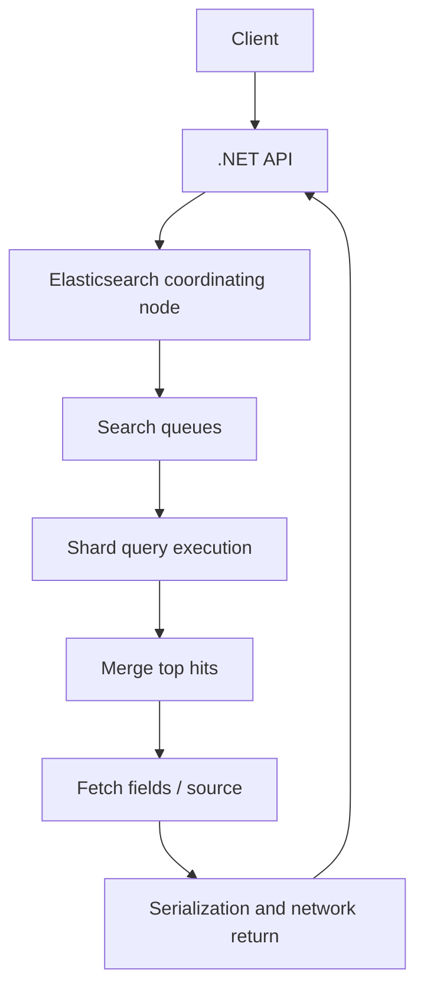

# Chapter 04 — Search Performance, Scaling and Reliability

## 1. Start with service targets

Specify document and index size, ingestion/update rate, query throughput, query distribution, p95/p99 latency and availability. Hypothetical exercise: 500 searches/s, p95 target 150ms, 99.9% availability.

A search system can be fast but irrelevant, or relevant but unstable. Track quality and reliability independently.

## 2. End-to-end latency is not Lucene query time



The Elasticsearch Profile API measures detailed query execution work, not full end-to-end application latency, nor all coordinating/queueing/fetch costs. Compare API trace time, Elasticsearch response `took`, and shard query profiles. Multiple shard operations overlap; don't blindly add their durations.

If API=800ms but Elasticsearch `took`=70ms, investigate .NET application processing, client retries, networking, serialization and response size. If `took`=650ms but query profiles show only ~40ms, inspect queueing, fetch, coordination and node contention.

## 3. Investigation framework

**Observe → generate hypotheses → measure → change one variable → validate.**

| Observation | Competing hypotheses |
|---|---|
| Latency rises during bulk ingest | Merge I/O, indexing contention, queues, GC, other traffic |
| Search thread-pool queues grow | Node saturation, hot shards, expensive query load |
| Disk I/O and merge time rise | Background segment consolidation competing with reads/writes |
| Single query regresses | Analyzer/mapping changes, wildcard/aggregation cost, selectivity |
| Deep pages slow | Excess per-shard candidate collection and fetch work |
| Some requests stale | Refresh visibility, routing, alias, synchronization lag |

Large JVM heap isn't the automatic fix: OS page cache is valuable for segment file reads. More shards isn't automatically faster: each shard carries per-shard costs and fan-out overhead. More replicas may improve concurrency if resources allow, but add write overhead.

## 4. Useful diagnostic APIs

```http
GET _cluster/health
GET _cat/nodes?v
GET _cat/shards/products-v1?v
GET _cat/segments/products-v1?v
GET products-v1/_stats/indexing,search,merges,refresh,segments,translog
GET _nodes/stats/jvm,fs,thread_pool,indices
```

Profile representative queries:

```json
GET products-v1/_search
{
  "profile": true,
  "query": {
    "bool": {
      "must":[{"match":{"name":"organic vitamin"}}],
      "filter":[{"term":{"inStock":true}}]
    }
  }
}
```

Use profiling along with distributed traces and metrics; profiling adds overhead and does not account for every server/client phase.

## 5. Pagination and data freshness

Deep `from/size` windows require collecting many candidates across shards; `index.max_result_window` commonly defaults to 10,000. For deep sequential paging use `search_after` with stable sort and often point-in-time (PIT) search to preserve a consistent traversal view. Trade-off: difficult arbitrary jumps to page N.

Caching may occur in the filesystem page cache, Elasticsearch caches or application response caches. They differ: cached Lucene file pages are not necessarily cached search responses. Stock/price availability can become stale; consider validation against authoritative systems as dictated by product requirements.

## 6. Reliability patterns

- Bound client timeouts and propagate cancellation.
- Use bounded, jittered retries only for appropriate operations; blind retries can amplify overload.
- Monitor search queues, rejections, GC, disk I/O, shard relocations and CDC lag.
- Decide explicitly whether partial shard results are acceptable.
- Optionally fall back from vector/reranked search to lexical results when quality rules permit.
- Do not force-merge actively updated indices as a reflexive incident fix.
- Replication is not backup; maintain snapshots and source-of-truth recovery.

## 7. Example instrumentation

```csharp
using System.Diagnostics;
using System.Net.Http.Json;

public static async Task<string> SearchAsync(
    HttpClient client,
    string index,
    object query,
    ILogger logger,
    CancellationToken cancellationToken)
{
    var timer = Stopwatch.StartNew();
    using var response = await client.PostAsJsonAsync(
        $"/{index}/_search", query, cancellationToken);
    var body = await response.Content.ReadAsStringAsync(cancellationToken);

    logger.LogInformation("Search HTTP {Status} completed in {ElapsedMs}ms",
        (int)response.StatusCode, timer.ElapsedMilliseconds);

    response.EnsureSuccessStatusCode();
    return body;
}
```

This times the client's HTTP call and response read. It does **not** independently measure Elasticsearch server `took`, JSON parsing or downstream transformations. Prefer supported Elasticsearch .NET client and structured OpenTelemetry tracing for production. Don't log sensitive query contents indiscriminately.

## 8. Incident worked example

During reindex, hypothetical metrics change:

| Metric | Baseline | Incident |
|---|---:|---:|
| p95 | 120ms | 850ms |
| Indexing | 2,000 docs/s | 7,500 docs/s |
| Queue | 0–5 | 150–300 |
| Disk I/O utilization | 35% | 95% |
| Merge activity | Low | High |

Indexing-related contention is plausible, but rising merges are not proven root cause. Compare node-level timing, disk latency, queues, query profiles and deployment traffic. If confirmed, rate-limit ingestion, right-size batches/resources and measure CDC backlog and freshness. Validate p95 recovery without introducing missed writes or unbounded lag.

## 9. Spoken answer

> "I'd start with workload targets and instrument the complete execution path: application time, Elasticsearch server time, queues, shard-level query costs, fetch, network and serialization. I'd examine whether latency correlates with ingestion, merges, GC, disk pressure or query changes, rather than assume more shards or nodes will fix it. Then I'd make a controlled change, load-test representative queries and confirm latency, relevance and indexing freshness together."

## Revision

- p95 and p99 expose tail latency; throughput and errors matter too.
- Search profiles do not equal end-to-end time.
- Segment count, shard count and replica count solve different problems.
- Paging, caching and retries need explicit correctness/freshness decisions.
- Evidence-driven production debugging is a senior-engineering skill.
