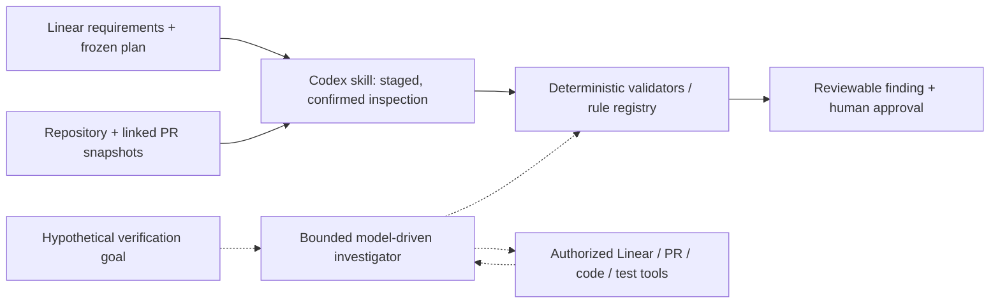

# PlanForge → Carve: source-grounded architecture mapping

## November 18 — Actual PlanForge repository audit: deterministic vs agentic

**Source reviewed:** private `dheerix/planforge` on `main` (README, `skills/planforge/SKILL.md`, deviation scripts, evidence collectors, comparison-input builder, deviation rule/status models).

**Do not call current PlanForge a production bounded agent.** It is a **Codex-operated, instruction-driven skill with deterministic support scripts and human gates**. Its skill directs Codex to read Linear context and inspect user-confirmed repositories; some discovery/interpretation is model-assisted and therefore not inherently deterministic. The checked-in Ruby/Python analysis, normalization, rendering and validation utilities are deterministic for the same inputs.

### Implemented mechanisms and boundaries

| Current code | What it demonstrably does | What it does NOT by itself demonstrate |
|---|---|---|
| `skills/planforge/SKILL.md` | Prescribed intake → confirmed repo scope → design → frozen plan, explicit human confirmation before advancing or external writes | Self-contained autonomous model tool loop with persisted decision budget |
| `collect_repository_evidence.rb` | Read-only Git branch, commit, worktree state and provenance across listed repositories | Semantic verification of all changed code and acceptance criteria |
| `collect_pull_request_evidence.rb` | Normalizes supplied PR snapshot and rejects PR URLs absent from frozen repository plan | Fetching arbitrary live PRs or independently analyzing every diff |
| `collect_linear_evidence.rb` | Normalizes provided Linear snapshot bound to frozen project identity | Arbitrary model-directed Linear access |
| `build_comparison_input.rb` | Checks frozen plan ID/version across inputs; rejects unknown source IDs and joins explicit checks/evidence | Discovering missing criteria automatically |
| `deviation-rules.json` | Defined categories: contract-drift, missing-acceptance-coverage, scope-drift, deferred-recovery-gap, lifecycle-recovery-gap | A learned or autonomous violation detector |
| `analyze_deviations.rb` | Validates **supplied** findings against rules/status/evidence fields; emits JSON and reviewable Linear comment | Proving each PR satisfies every original requirement |
| `deviation-status-model.json` | Allowed lifecycle transitions for detected, acknowledged, resolving, blocked, resolved, accepted risk, dismissed, stale | Final approval by an AI model |
| `prepare_linear_handoff.rb` | Reviewable handoff; external posting not automatic | Unapproved Linear writes |

The important implementation gap is **upstream evidence discovery and semantic requirement-coverage determination**. The deterministic deviation analyzer expects structured candidate findings rather than generating them from an arbitrary code diff. The README's broader experience language describes the product ambition; distinguish verified script behavior from workflow aspirations.

### End-to-end analogy with Carve

| Dimension | PlanForge now | Carve-like assessment |
|---|---|---|
| Canonical criteria | Frozen Linear implementation plan + original product requirements | Approved readiness criteria / domain methodology |
| Existing context | Repository code/contracts | Governing engineering documents, approvals, action registers |
| Changed/submitted evidence | PR metadata/diffs, tests, repository snapshots | Uploaded project deliverables and revisions |
| Evidence discovery | Codex-guided repo inspection + supplied snapshots; deterministic collectors | Search/inspect current authorized engineering sources |
| Comparison/checking | Structured checks + explicit deviation rule registry | Explicit criterion-to-evidence evaluation, gaps and conflicts |
| Governance | Human gates, approval/transition logic, no silent Linear posting | Domain expert review, policy gate, traceable readiness approval |

**Hypothetical bounded-agent evolution, NOT shipped:** Given "verify PR #1842 against frozen requirements", model selects among allow-listed `accessLinearProject`, `checkPR`, `checkRepoCode`, `runTests`, and narrowly scoped `accessBrowser`; backend validates permissions, tool arguments and time/step/cost budgets; each tool result is checkpointed; loop stops at evidence sufficiency, non-progress or budget exhaustion; findings are passed to the **existing deterministic analysis and human review layer**. Browser/network access and test execution are higher-risk and require isolation/allow-listing. Merely providing tools doesn't make the pipeline agentic; model-directed adaptive sequencing does.

### Carve conversation positioning

> "PlanForge currently follows a structured Codex skill with deterministic evidence collectors, rule-driven deviation analysis and human approval gates. We've built the verification scaffolding; the more adaptive question is how to discover sufficient PR/code evidence and decide what to investigate next. An agentic evolution could select scoped Linear, PR, code and test tools while preserving deterministic assessment rules. I see a parallel with Carve's engineering requirements, revisioned documents and readiness evidence."

Ask Brad: **"Does Carve already have a strong criterion/evidence contract, with agents primarily investigating sources, or are agents also expected to define how evidence is evaluated?"**

**Interview distinction:** Inventory Upload Anything = acquiring structured evidence; PlanForge = plan/requirements-to-evidence checks and deviations; Guardlane = product policy over uncertain model predictions.

## Quick visual — current versus hypothetical

Solid edges are current architectural responsibilities described in the repository; dashed edges are a **proposed agentic evolution**, not delivered functionality.

## Source links

- [PlanForge README](https://github.com/dheerix/planforge/blob/main/README.md)
- [PlanForge SKILL.md](https://github.com/dheerix/planforge/blob/main/skills/planforge/SKILL.md)
- [Deviation analyzer](https://github.com/dheerix/planforge/blob/main/skills/planforge/scripts/analyze_deviations.rb)
- [Deviation rule registry](https://github.com/dheerix/planforge/blob/main/skills/planforge/references/deviation-rules.json)
- [Evidence contract](https://github.com/dheerix/planforge/blob/main/skills/planforge/references/deviation-evidence-contract.md)
- [PR evidence collector](https://github.com/dheerix/planforge/blob/main/skills/planforge/scripts/collect_pull_request_evidence.rb)
- [Repository evidence collector](https://github.com/dheerix/planforge/blob/main/skills/planforge/scripts/collect_repository_evidence.rb)
- [Comparison input builder](https://github.com/dheerix/planforge/blob/main/skills/planforge/scripts/build_comparison_input.rb)

**Repository visibility:** PlanForge is private; only authenticated viewers with access can open these links. This mapping contains architecture descriptions but no private source copied into the public interview notes.
